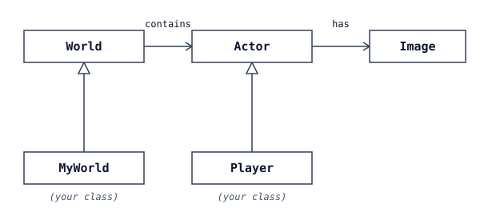
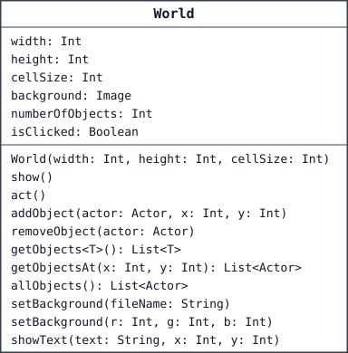
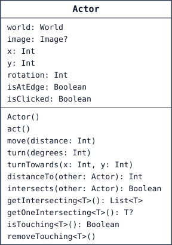
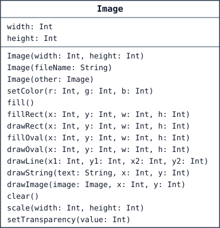

# BluePlay

BluePlay is a small Kotlin game library, a didactic alternative to Greenfoot,
which does not exist for Kotlin. It was written for BlueJ and the inf-schule
course [“OOP with Kotlin”](https://www.inf-schule.de/oopk). Students program
simple graphical games and simulations with worlds, actors, images and sounds.
BlueK supplies a browser version of its BlueJ student API.

Choose a BluePlay project under **New Project**. The library cards World, Actor,
Image and BluePlayFunctions represent the built-in library rather than editable
project files. Double-click a library card to open API help. After compilation,
right-click World, Actor or Image to call a public constructor and put an
instance on the object bench. Image offers its size, file and copy constructors.
Library cards cannot be edited, duplicated or deleted, or have a test class
created for them.

**Contents:** [Minimal example](#minimal-example) ·
[Project structure](#how-a-blueplay-project-is-structured) ·
[World](#world) · [Actor](#actor) · [Image](#image) ·
[Global functions](#global-functions) · [Running a world](#running-a-world) ·
[Images and sounds](#images-and-sounds) ·
[BlueJ version and compatibility](#bluej-version-and-compatibility)

## Minimal example

```kotlin
class MyWorld : World(600, 400, 1) {
    init {
        addObject(Figure(), 100, 200)
    }
}

class Figure : Actor() {
    init {
        image = Image("figure.png")
    }
    override fun act() {
        move(1)   // walks slowly to the right
    }
}

fun main() {
    val world = MyWorld()
    world.show()
}
```

Compile, click **Start main** to show the world, then click **Run**.

## How a BluePlay project is structured

A BluePlay project consists of the library classes `World`, `Actor` and `Image`
and your own classes. `BluePlayFunctions` contains global functions, for
example for reading the keyboard and playing sounds. In BlueK the library is
built in; your own classes are ordinary project files.

The classes work together like this:



An `Actor` has an image (`Image`) and lives in a `World`. A `World` contains
any number of `Actor` objects. Your classes inherit from `World` and `Actor`.

### Your own world

Your own world is a subclass of `World`. In the constructor you set its size:
width and height in cells, and the size of one cell in pixels.

```kotlin
class MyWorld : World(600, 400, 1) {
}
```

### Your own figure

A figure is a subclass of `Actor`. It gets an image and describes, in the
method `act()`, what should happen on every step. `act()` is called
automatically, over and over, while the game is running.

```kotlin
class Player : Actor() {
    init {
        image = Image("player.png")
    }

    override fun act() {
        if (isKeyDown("right")) x += 3
    }
}
```

### The main program

In the main program you create the world, add figures with `addObject(...)`,
and display the world with `show()`. A world never shows itself automatically.
**Reset** calls the chosen `main()` function again.

```kotlin
fun main() {
    val world = MyWorld()
    world.addObject(Player(), 300, 200)
    world.show()
}
```

## World

A `World` is the playfield: a grid of `width` × `height` cells, where each
cell is `cellSize` pixels in size. Your own world is a subclass of `World`.
`cellSize` is a required constructor argument.



The `<T>` in `getObjects` is a placeholder for a type: at the call site you
plug in the class you want. `getObjects<Coin>()`, for example, returns all
coins.

### Examples

```kotlin
// A world with 600x400 cells (1 pixel each)
class MyWorld : World(600, 400, 1)
```

```kotlin
// Create a world, add an object, and show it
val world = MyWorld()
world.addObject(Player(), 300, 200)
world.show()
```

### API

| **Properties** | |
|---|---|
| `width, height, cellSize: Int` | Width and height of the field (in cells) and the size of one cell (in pixels). Set in the constructor. |
| `background: Image` | The world's background image. |
| `numberOfObjects: Int` | Number of actor objects currently in the world. |
| `isClicked: Boolean` | `true` if the world itself (not an actor) was just clicked. |
| **Constructor** | |
| `World(width: Int, height: Int, cellSize: Int)` | Creates a world with width × height cells of cellSize pixels each. |
| **Methods** | |
| `show()` | Shows the world in the world window and pauses the simulation. A world does not show itself automatically. |
| `act()` | Called on every step. Override to program the behaviour of the whole world. |
| `addObject(actor: Actor, x: Int, y: Int)` | Adds an actor to the world at position (x, y); an actor in another world moves here. |
| `removeObject(actor: Actor)` | Removes an actor from the world. |
| `getObjects<T : Actor>(): List<T>` | Returns all actor objects of type T, e.g. `getObjects<Coin>()`. |
| `getObjectsAt(x: Int, y: Int): List<Actor>` | Returns all actor objects in cell (x, y). |
| `allObjects(): List<Actor>` | Returns a copy of the list of all actor objects in the world. |
| `setBackground(fileName: String)` | Loads an image as the background and scales it to the world size. |
| `setBackground(r: Int, g: Int, b: Int)` | Fills the background with a color (r, g, b each 0..255). |
| `showText(text: String, x: Int, y: Int)` | Shows text at cell (x, y). `""` removes the text there again. |

## Actor

An `Actor` is a figure that lives in a `World` and has an image. Your own
figures are subclasses of `Actor` and override the method `act()`. The
position (`x`, `y`) is given in cells.



The `<T>` (e.g. in `getOneIntersecting`) is a placeholder for a type: at the
call site you plug in the class you want. `getOneIntersecting<Coin>()`, for
example, returns a touched coin.

### Examples

```kotlin
// A coin that slowly turns on every step
class Coin : Actor() {
    init {
        image = Image("coin.png")
    }

    override fun act() {
        turn(3)
    }
}
```

```kotlin
// In a figure's act(): collect a touched coin
val coin = getOneIntersecting<Coin>()
if (coin != null) {
    world.removeObject(coin)
}
```

### API

| **Properties** | |
|---|---|
| `world: World` | The world this actor is in. Throws an `IllegalStateException` if the actor has no world. |
| `image: Image?` | The actor's image (appearance). `null` shows a placeholder. |
| `x, y: Int` | Position in cells. Automatically clamped to the world boundaries. |
| `rotation: Int` | Heading in degrees (0 = right, clockwise). |
| `isAtEdge: Boolean` | `true` if the actor is at the edge of the world. |
| `isClicked: Boolean` | `true` if this actor was just clicked. |
| **Constructor** | |
| `Actor()` | Creates a new figure without a world. Set its image afterwards via the `image` property (usually in the `init` block). |
| **Methods** | |
| `act()` | Called on every step. Override to program the figure's behaviour. |
| `move(distance: Int)` | Moves the actor by `distance` cells in its current heading. |
| `turn(degrees: Int)` | Turns the heading by `degrees`. |
| `turnTowards(x: Int, y: Int)` | Turns the heading towards cell (x, y). |
| `distanceTo(other: Actor): Int` | Distance to another actor (in cells). |
| `intersects(other: Actor): Boolean` | `true` if visible pixels of this actor's image overlap visible pixels of the other actor's image. Transparent pixels are ignored. |
| `getIntersecting<T : Actor>(): List<T>` | All overlapping actor objects of type T. |
| `getOneIntersecting<T : Actor>(): T?` | One overlapping actor of type T, or `null`. |
| `isTouching<T : Actor>(): Boolean` | `true` if at least one actor of type T overlaps. |
| `removeTouching<T : Actor>()` | Removes one overlapping actor of type T from the world. |

Use Kotlin properties such as `actor.image = Image("duck.png")`, not Java-style
setImage/getX helpers. `world`, `isAtEdge`, `isClicked` and the collision
methods require a world; without one they throw an `IllegalStateException`.
Movement, rotation and image changes also work without a world. Inspectors
display getter errors without ending the session.

Movement supports arbitrary angles and rounds to whole cells. Coordinates are
clamped to world boundaries. `turnTowards` at the actor's own location retains
its rotation. Membership and collisions use object identity, even with an
overridden `equals`. Transparent image pixels do not collide or receive clicks.

## Image

An `Image` is a picture. It serves as the appearance of an `Actor` object or
the background of a `World`. You can load an image from a file or draw on it
yourself.



### Examples

```kotlin
// Load an image from a file (from the images/ folder)
image = Image("player.png")
```

```kotlin
// Draw an image yourself: a red circle, 30x30 pixels
val picture = Image(30, 30)
picture.setColor(255, 0, 0)
picture.fillOval(0, 0, 30, 30)
image = picture
```

### API

| **Properties** | |
|---|---|
| `width, height: Int` | Width and height of the image, in pixels. |
| **Constructors** | |
| `Image(width: Int, height: Int)` | Creates an empty, transparent image of the given size (in pixels). |
| `Image(fileName: String)` | Loads an image file (PNG or JPEG) from the `images/` folder. |
| `Image(other: Image)` | Creates a copy of an existing image. |
| **Methods** | |
| `setColor(r: Int, g: Int, b: Int)` | Sets the drawing color (r, g, b each 0..255). |
| `fill()` | Fills the whole image with the drawing color. |
| `fillRect(x: Int, y: Int, w: Int, h: Int)` | Draws a filled rectangle. |
| `drawRect(x: Int, y: Int, w: Int, h: Int)` | Draws the outline of a rectangle. |
| `fillOval(x: Int, y: Int, w: Int, h: Int)` | Draws a filled oval. |
| `drawOval(x: Int, y: Int, w: Int, h: Int)` | Draws the outline of an oval. |
| `drawLine(x1: Int, y1: Int, x2: Int, y2: Int)` | Draws a line. |
| `drawString(text: String, x: Int, y: Int)` | Writes text at position (x, y). |
| `drawImage(image: Image, x: Int, y: Int)` | Draws a copy of another image at position (x, y). |
| `clear()` | Makes the image fully transparent. |
| `scale(width: Int, height: Int)` | Scales the image to a new size. |
| `setTransparency(value: Int)` | Opacity from 0 (invisible) to 255 (opaque). |

Image dimensions are at least one pixel. A missing file raises “Image file not
found”. `drawImage` copies the source's content and transparency at call time;
`scale` changes the existing content. Loaded images can receive additional
drawing operations.

## Global functions

Besides the classes, BluePlay has a few global functions. They don't belong to
any class and live in `BluePlayFunctions`. You can call them directly
anywhere, for example `isKeyDown("up")` inside a figure's `act()`.

### Examples

```kotlin
// In a figure's act(): move up/down with the arrow keys
override fun act() {
    if (isKeyDown("up"))   y -= 3
    if (isKeyDown("down")) y += 3
}
```

```kotlin
// Play a sound (from the sounds/ folder)
playSound("pickup.wav")
```

### API

| **Functions** | |
|---|---|
| `isKeyDown(key: String): Boolean` | `true` while the key is held down. Names include `"left"`, `"right"`, `"up"`, `"down"`, `"space"`, `"enter"`, and single characters such as `"a"` or `"7"`. |
| `start()` | Starts the game (calls `act()` continuously). |
| `stop()` | Stops the game. |
| `step()` | Runs exactly one step. |
| `getSpeed(): Int` | Returns the current speed (1..100). |
| `setSpeed(value: Int)` | Sets the speed (1..100). |
| `playSound(fileName: String)` | Plays a WAV or MP3 file from the `sounds/` folder once. |

## Running a world

The world window always has, from left to right, **Act**, **Run** and **Reset**, then
**Speed**, including projects without a main function. BlueJ's BluePlay labels
the first two buttons Step and Start/Stop.
While the world runs, Run turns into **Pause**; the three buttons keep the same
size in every state. Exported players use the same controls.
While the world runs, its window cannot be closed (the close button is
disabled and Escape keeps it open); pause it first. If Run starts while the
window is closed, for example through `start()` in the codepad, the window
opens again.
Speed works exponentially like Greenfoot's slider: about 1 s per step at 1,
30 ms at the default 50 and 1 ms at 100; the left half therefore slows down
considerably. Run performs its first step at once, and raising the speed
shortens a wait that is already running. Programs tuned for BlueJ's BluePlay
(`100 - speed` ms) run somewhat faster at the default speed.
One step calls World.act and then act on actors still present in the world.
Showing a world pauses simulation and reopens a previously closed world window.
Reset invokes the chosen main again in the existing session; it does not rerun
top-level property initialization. Without a main function, Reset has no effect.
Compiling closes the previous world and replaces the runtime session, just as
it removes objects from the object bench. It does not run main automatically;
click **Start main** to create and show the world from the updated program.
Keyboard/mouse input remains available during
Run. Pause before using codepad/object operations.

The canvas retains its real pixel size (`width * cellSize`, `height * cellSize`).
Large worlds scroll; maximizing changes the window, not the world's scale.

## Images and sounds

Standard images such as `duck.png`, `cat.png` and `pizza.png` are bundled.
A project resource with the same path takes precedence. Only project resources
are saved/exported/listed as project files.

BluePlay's 13 standard sounds are bundled as well: `beep.wav`, `cat.wav`,
`dog.wav`, `explosion.wav`, `frog.wav`, `hit.wav`, `jump.wav`, `lose.wav`,
`magic.wav`, `pickup.wav`, `shoot.wav`, `step.wav` and `win.wav`. Like the
standard images they are not stored in the project, and a project sound with
the same name takes precedence.

Add sounds with the **Audio** button of a BluePlay project. It lists the
project's sounds and the standard sounds and previews them. Project sounds can
be renamed and, after confirmation, removed; standard sounds cannot. A rename
keeps the file type (a name without extension gets the old one) and refuses a
name another project sound already has. Calls in the source keep the old name,
so update `playSound` calls yourself. Accepted
formats are **WAV** and **MP3**, at most 1 MB per file: WAV for short effects
and BlueJ compatibility, MP3 for longer sounds or music. Other formats such as
OGG or M4A are rejected because not every browser or BlueJ plays them; files
the browser cannot decode are rejected as well. Adding or removing a sound
requires Compile.

`playSound("pop.wav")` plays `sounds/pop.wav` once; `playSound("sounds/pop.wav")`
works too. Sounds overlap and also play without a shown world, e.g. from the
codepad. A missing file raises “Sound file not found”. Reset and Compile stop
playing sounds. Audible output depends on the device and on the browser's
autoplay rules, which allow sound after a click or key press.

Add images with the **Images** button. Accepted formats are **PNG** and
**JPEG** (`.jpg`/`.jpeg`), at most 1 MB and 2048 pixels per side, for actors as
well as world backgrounds. Collisions, `isTouching` and clicks use the image's
alpha channel pixel by pixel (alpha above 16, as in BlueJ): transparent PNG
pixels never collide, while a JPEG has no transparency and collides as its full
rectangle. GIF (only its first frame would be used and transparency is 1-bit),
WebP (not readable by BlueJ), SVG (no fixed pixels for a mask), BMP and AVIF are
rejected; convert them to PNG. Project images can be renamed and, after
confirmation, removed like sounds; the file type is kept (`.jpg` and `.jpeg`
count as one type). Standard images cannot be changed but are replaced by a
project image with the same name. Adding, renaming or removing requires
Compile; `Image("…")` calls in the source keep their old names.

## BlueJ version and compatibility

BluePlay was first developed as a BlueJ project (BlueJ 6 or later with Kotlin
support). BlueK is now the only maintained version. **Open** accepts
BlueJ projects written with BluePlay: their BluePlay library files are replaced
by the built-in library, while your own classes, images and sounds are
imported. **Save → Export BlueJ Project (.zip)** works the other way:
the ZIP contains the BlueJ version of the library, your classes and all
standard images and sounds in `images/` and `sounds/`; open the unpacked folder
in BlueJ. In BlueJ, `playSound` plays WAV files only; if the project has MP3
sounds, a notice after the export names them. The final BlueJ version
is kept in BlueK as the pinned
[BlueJ reference](../tests/fixtures/blueplay-reference/README.md).

Signatures, original student files and collision cases are checked against
that reference. JVM/AWT internals, java.awt.Color and file access are outside
the browser API. Browser font metrics/antialiasing are not pixel-identical to
AWT; text collision uses a geometric approximation. No universal frame-rate
guarantee is made.

Developer references: [engine and scheduler](blueplay-internals.md),
[API audit](blueplay-api-audit.md).
